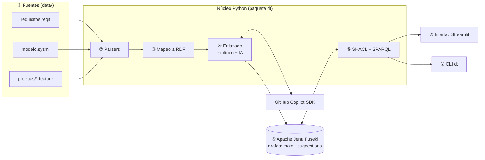

# Arquitectura y alcance de la solución

| Campo | Valor |
|---|---|
| Proyecto | `knowledge-digital-thread` · Proyecto 4: Digital Thread basado en un grafo de conocimiento de ingeniería |
| Documento | Arquitectura, tecnologías y alcance del MVP |
| Versión | 0.2 (borrador) |
| Fecha | 2026-11-05 |
| Estado | Pendiente de aprobación por el equipo |

---

## 1. Propósito del documento

Este documento define **qué se va a construir, con qué tecnologías y hasta dónde llega cada parte** de la herramienta. El alcance está ajustado a un plazo de **un mes de desarrollo**.

Cada elección tecnológica se justifica frente a las alternativas consideradas. Las decisiones más relevantes se formalizarán como ADR en `docs/adr/` (ver [sección 9](#9-decisiones-de-arquitectura-adr)).

Criterios usados para decidir:

1. **Cumplir todos los requisitos del enunciado.** No se recorta nada que se pida de forma explícita.
2. **Basarse en estándares** (W3C, OMG, OSLC), como exige el enunciado.
3. **Minimizar el número de piezas y lenguajes** para que el MVP sea alcanzable en cuatro semanas.
4. **Favorecer el desarrollo asistido por IA**: tecnologías maduras, bien documentadas, configurables como texto versionable y con ciclos de prueba rápidos.
5. **Que todo sea verificable**: las decisiones del sistema son deterministas y la IA solo propone o explica.

---

## 2. Restricciones y requisitos de partida

### 2.1 Requisitos del enunciado (proyecto 4)

| Resultado esperado | Cómo se cubre | Sección |
|---|---|---|
| Grafo de conocimiento funcional | Grafo RDF en Apache Jena Fuseki | [4.5](#45-almacenamiento-del-grafo) |
| Ingesta de al menos tres tipos de artefactos | Requisitos (ReqIF), modelo lógico (SysML v2) y casos de prueba (Gherkin) | [4.1](#41-caso-de-estudio-y-formatos-de-entrada), [4.2](#42-ingesta-parsers) |
| Identificación de relaciones y dependencias | Enlaces explícitos + enlaces sugeridos por IA | [4.4](#44-enlazado-de-artefactos) |
| Interfaz de consulta y navegación | Aplicación web con Streamlit | [4.8](#48-interfaz-de-usuario) |
| Demostración de trazabilidad extremo a extremo | Cadena requisito → parte del modelo → caso de prueba, navegable y consultable | [4.6](#46-validación-y-consulta), [4.8](#48-interfaz-de-usuario) |

### 2.2 Requisitos generales del enunciado

| Requisito | Cómo se cubre | Sección |
|---|---|---|
| Uso de IA generativa (OpenSpec / GitHub Copilot SDK) | Copilot SDK **en el sistema** (enlaces sugeridos) y OpenSpec **en el proceso** | [4.4](#44-enlazado-de-artefactos), [4.9.5](#495-proceso-de-desarrollo-con-ia) |
| Sistema definido en términos de estándares | ReqIF, SysML v2, Gherkin, RDF, OWL, SHACL, SPARQL, OSLC | [3](#3-visión-general-del-flujo) |
| Pruebas automatizadas unitarias y funcionales | pytest en GitHub Actions | [4.9.3](#493-pruebas) |
| Scrum en GitHub (sprints, issues, etiquetas, ramas) | GitHub Projects + flujo de ramas | [4.9.6](#496-gestión-del-proyecto) |
| Configuración automatizada de herramientas | Todo definido como código (Dockerfile, Compose, configuración de Fuseki en Turtle) | [4.9.1](#491-construcción-y-despliegue) |
| Construir y desplegar en una máquina nueva con un único comando | `make all` sobre Docker Compose | [4.9.1](#491-construcción-y-despliegue) |
| Pipeline de construcción | GitHub Actions | [4.9.2](#492-integración-y-entrega-continua) |
| Métricas de calidad de código | Ruff, pytest-cov, radon | [4.9.4](#494-calidad-de-código) |
| Empaquetado y distribución (CD) | Imágenes Docker publicadas en GHCR | [4.9.2](#492-integración-y-entrega-continua) |
| Documentación versionada, autogenerada y con referencias cruzadas | MkDocs Material en GitHub Pages + matriz de trazabilidad generada | [4.9.7](#497-documentación) |

### 2.3 Restricción de plazo

Hay **cuatro semanas** de desarrollo. Por eso:

- Se implementa **una única funcionalidad de IA en el sistema** (enlaces sugeridos), elegida porque es medible y sostiene la hipótesis.
- Todo el sistema se escribe en **un solo lenguaje (Python)**: no hay API REST independiente ni frontend en otro lenguaje.
- El caso de estudio tiene un **tamaño acotado**.
- La gestión de versiones del grafo y el diff antes/después quedan **fuera de alcance**. Se solapan con el proyecto 9 (análisis de impacto).

---

## 3. Visión general del flujo



| Paso | Responsabilidad | Tecnología principal |
|---|---|---|
| ① Fuentes | Artefactos del caso de estudio en formatos estándar | ReqIF · SysML v2 textual · Gherkin |
| ② Ingesta | Leer cada formato y producir objetos de dominio | Python · `reqif` · Lark · `gherkin-official` |
| ③ Modelo semántico | Traducir los objetos a RDF según la ontología | RDF · OWL 2 · OSLC · `rdflib` |
| ④ Enlazado | Resolver enlaces explícitos y proponer implícitos | Python · GitHub Copilot SDK |
| ⑤ Almacenamiento | Persistir el grafo y exponer SPARQL | Apache Jena Fuseki (TDB2) |
| ⑥ Validación y consulta | Detectar huecos, trazar e identificar impacto | pySHACL · SPARQL 1.1 |
| ⑦ CLI | Ejecutar la herramienta desde la terminal y el CI | Typer |
| ⑧ Interfaz | Navegar, consultar y revisar sugerencias | Streamlit · `st-cytoscape` |

### 3.1 Ejemplo que recorre todo el flujo

Sistema de ejemplo: un **dron de reparto**.

1. `requisitos.reqif` contiene `REQ-001`: *"El dron debe tener una autonomía mínima de 30 minutos"*.
2. `modelo.sysml` declara `part def Battery` y la relación `satisfy REQ-001 by battery`.
3. `pruebas/autonomia.feature` contiene el escenario `TC-07`, etiquetado como `@REQ-001`.
4. `pruebas/viento.feature` contiene `TC-12` *"aterrizar con viento de 40 km/h"*, **sin etiqueta**. La IA propone enlazarlo con `REQ-009` (*"operar con viento ≤ 40 km/h"*).
5. En la interfaz, al seleccionar `REQ-001`, se resalta la cadena `REQ-001 → Battery → TC-07`. La matriz de cobertura muestra `REQ-009` como **no verificado** hasta que se acepta la sugerencia.

---

## 4. Detalle por sección

Cada sección sigue la misma estructura: **responsabilidad**, **alcance** (lo que entra y lo que no) y **tecnologías** (elección, justificación y alternativas descartadas).

### 4.1 Caso de estudio y formatos de entrada

**Responsabilidad:** proporcionar artefactos realistas, en formatos estándar, sobre los que demostrar la trazabilidad.

**Alcance**

| Incluido | Fuera de alcance |
|---|---|
| Caso de estudio *dron de reparto* con **~15 requisitos, ~10 partes y ~15 casos de prueba** | Conexión con herramientas comerciales (DOORS, Cameo, Polarion) |
| **Enlaces de referencia** (*ground truth*) documentados en `data/ground-truth.csv` | Resultados de ejecución de pruebas (JUnit XML): queda como extra |
| **Defectos inyectados** a propósito: requisitos sin satisfacer, requisitos sin verificar, pruebas sin etiqueta | Varios casos de estudio |

**Tecnologías**

| Artefacto | Elección | Justificación | Alternativas descartadas |
|---|---|---|---|
| Requisitos | **ReqIF 1.2** (OMG) | Es el estándar de intercambio de requisitos entre herramientas industriales y aparece en la lista del enunciado. Usarlo demuestra que la herramienta podría alimentarse de una exportación real | CSV/Excel: sin estándar ni semántica. Markdown con IDs: no interoperable |
| Modelo lógico | **SysML v2, notación textual** (`.sysml`) | Es el estándar actual de MBSE. Al ser texto se versiona en Git y se puede escribir a mano o con IA. Tiene relaciones nativas `satisfy` y `verify`, de las que salen los enlaces explícitos | SysML v1/XMI: XML muy verboso y dependiente de herramientas de pago. JSON de la API SysML v2: exige desplegar otro servidor |
| Casos de prueba | **Gherkin** (`.feature`) | Formato estándar de facto para especificar pruebas, legible por personas. Las etiquetas (`@REQ-001`) son un mecanismo de enlace natural | TestLink, Xray: comerciales o con servidor propio. CSV: no estructurado |

**Convención de identificadores:** todo artefacto tiene un identificador único y estable (`REQ-001`, `PART-Battery`, `TC-07`). En SysML v2 se usa el *short name* (`part def <'PART-Battery'> Battery;`) para conservar el ID.

### 4.2 Ingesta (parsers)

**Responsabilidad:** leer cada fichero fuente y producir objetos de dominio independientes del formato (`Requirement`, `Part`, `TestCase`).

**Alcance**

| Incluido | Fuera de alcance |
|---|---|
| Un parser por formato, con tests unitarios | Gramática completa de SysML v2 |
| Subconjunto de SysML v2: `package`, `part def`, `part`, `requirement` (por referencia), `satisfy … by …`, `verify` | Acciones, estados, conectores, puertos, restricciones |
| Errores de parseo informativos (fichero, línea, motivo) | Ingesta incremental o en tiempo real |

**Tecnologías**

| Decisión | Elección | Justificación | Alternativas descartadas |
|---|---|---|---|
| Lenguaje | **Python 3.12** | Es el único ecosistema con librerías maduras para los tres formatos, RDF, SHACL e IA a la vez. Un único lenguaje en todo el sistema reduce el coste de integración, y la IA generativa produce Python con alta fiabilidad | Java + Apache Jena: excelente para RDF, pero sin parsers maduros de ReqIF y Gherkin y con un desarrollo más lento. TypeScript: ecosistema RDF menos maduro |
| ReqIF | **`reqif`** (PyPI) | Librería mantenida que modela la especificación ReqIF completa | `lxml` a mano: habría que reimplementar el esquema ReqIF |
| SysML v2 | **Gramática propia con Lark** sobre el subconjunto definido | Ligera, en Python puro y fácil de testear. El subconjunto basta para la trazabilidad y se documenta en un ADR | SysML v2 Pilot Implementation: completa, pero Java/Eclipse y demasiado pesada para el CI. API REST SysML v2: otro servidor con su base de datos. Expresiones regulares: frágiles ante cualquier variación |
| Gherkin | **`gherkin-official`** | Es el parser oficial del proyecto Cucumber | `behave`: es un ejecutor de pruebas, no un parser |
| Modelos de dominio | **`dataclasses`** de la librería estándar | Sin dependencias y suficiente para el MVP | Pydantic: aporta validación, pero sin API REST no compensa añadirlo |

### 4.3 Modelo semántico (ontología y mapeo a RDF)

**Responsabilidad:** definir un vocabulario común y traducir los objetos de dominio a tripletas RDF.

**Alcance**

| Incluido | Fuera de alcance |
|---|---|
| Reutilizar vocabularios OSLC y Dublin Core | Ontología OWL completa con axiomas y razonamiento |
| Ontología propia `dt:` **mínima** (≤ 6 términos) para lo que OSLC no cubre | Alineamiento con ontologías de alto nivel (BFO, etc.) |
| URIs estables por artefacto | — |

**Vocabulario utilizado**

| Concepto | Término |
|---|---|
| Requisito | `oslc_rm:Requirement` |
| Caso de prueba | `oslc_qm:TestCase` |
| Parte del modelo lógico | `dt:Part` (subclase de `oslc_am:Resource`) |
| Requisito satisfecho por parte | `oslc_rm:satisfiedBy` |
| Caso de prueba que valida un requisito | `oslc_qm:validatesRequirement` |
| Identificador, título, descripción | `dcterms:identifier`, `dcterms:title`, `dcterms:description` |
| Enlace sugerido por IA | `dt:SuggestedLink` con `dt:subject`, `dt:predicate`, `dt:object`, `dt:confidence`, `dt:rationale`, `dt:status` |
| Fichero de origen | `dt:sourceFile` |

**Tecnologías**

| Decisión | Elección | Justificación | Alternativas descartadas |
|---|---|---|---|
| Modelo de datos | **RDF 1.1** | Estándar W3C citado en el enunciado. Es independiente del producto de almacenamiento y permite reutilizar vocabularios existentes | Property graph (Neo4j): no estandarizado y sin validación ni ontologías estándar |
| Vocabularios | **OSLC Core, RM, QM y AM** + **Dublin Core** | OSLC ya define las relaciones de trazabilidad del ciclo de vida. Reutilizarlas hace el grafo compatible con herramientas OSLC reales y evita inventar semántica | Ontología propia completa: no interoperable. Ontologías MBSE académicas: más complejas de lo necesario para el MVP |
| Ontología | **OWL 2 en Turtle** (`ontology/dt.ttl`) | Es estándar, se versiona como texto y es legible en revisiones de código | RDFS: menos expresivo. JSON-LD: menos legible para editar a mano |
| Librería | **`rdflib`** | Es la librería RDF de referencia en Python: parsea, serializa, ejecuta SPARQL en memoria y es la base de pySHACL | `pyoxigraph`: más rápida, pero con menos ecosistema |
| URIs | `https://w3id.org/kdt/id/{tipo}/{ID}` (provisional) | Los identificadores son estables entre ingestas y no dependen del fichero | Nodos en blanco: no se pueden referenciar ni enlazar |

### 4.4 Enlazado de artefactos

**Responsabilidad:** establecer las relaciones entre requisitos, partes y casos de prueba. Funciona en dos fases.

**Fase A: enlaces explícitos (deterministas).** Se resuelven las referencias que ya contienen los artefactos: `satisfy … by …` en SysML v2 y las etiquetas `@REQ-xxx` en Gherkin. Las referencias a IDs inexistentes se registran como avisos.

**Fase B: enlaces sugeridos (IA generativa).** Para los artefactos sin enlace explícito:

1. Se construyen los pares candidatos (requisito × parte y requisito × caso de prueba sin enlace).
2. Se envían **por lotes** al LLM a través del **GitHub Copilot SDK**, con un prompt que incluye los textos y los tipos de relación permitidos.
3. El LLM devuelve **JSON estructurado**: relación propuesta, confianza (0-1) y justificación.
4. Las sugerencias se guardan en el grafo `suggestions` con estado `pending`. El usuario las acepta o rechaza en la interfaz y, al aceptar una, el enlace se copia al grafo `main`.

**Alcance**

| Incluido | Fuera de alcance |
|---|---|
| Resolución de IDs explícitos con avisos de referencias rotas | Filtrado previo de candidatos con embeddings (innecesario con ~15×25 pares) |
| Sugerencias con Copilot SDK, confianza y justificación | Aprendizaje a partir de las sugerencias aceptadas o rechazadas |
| Aceptar o rechazar desde la interfaz | Explicación del impacto con IA, chat en lenguaje natural |
| **Sugerencias precalculadas** en `data/suggestions.ttl` para ejecutar sin credenciales | — |

**Tecnologías**

| Decisión | Elección | Justificación | Alternativas descartadas |
|---|---|---|---|
| IA generativa | **GitHub Copilot SDK** | Es una de las dos herramientas de referencia del enunciado, así que no requiere aprobación adicional. Se integra desde Python | APIs de OpenAI, Anthropic u Ollama: válidas técnicamente, pero requieren aprobación previa del profesor. Funciones de LLM integradas en triplestores (GraphDB): acoplan la IA al almacén y tampoco están aprobadas |
| Formato de respuesta | **JSON validado contra un esquema** | Hace que la salida del LLM se pueda procesar y probar. Las respuestas mal formadas se descartan y se registran | Texto libre: no se puede procesar de forma fiable |
| Separación de grafos | **`suggestions` aparte de `main`** | La IA nunca modifica el grafo validado sin aprobación humana. Así se puede auditar y medir su precisión | Escribir directamente en el grafo principal: no auditable |
| Aislamiento en tests | Interfaz `LinkSuggester` con un **doble de prueba** que devuelve respuestas grabadas | Los tests son deterministas, no consumen cuota y funcionan en el CI sin credenciales | Llamar al LLM en los tests: no determinista y requiere secretos |

### 4.5 Almacenamiento del grafo

**Responsabilidad:** persistir el grafo y exponerlo mediante protocolos estándar.

**Alcance**

| Incluido | Fuera de alcance |
|---|---|
| Fuseki con persistencia TDB2 en un volumen Docker | Versionado del grafo por commit y diff entre versiones |
| Dos grafos con nombre: `main` y `suggestions` | Inferencia OWL con razonador |
| Carga completa por grafo (reemplazo atómico) | Ingesta incremental |

**Tecnologías**

| Decisión | Elección | Justificación | Alternativas descartadas |
|---|---|---|---|
| Triplestore | **Apache Jena Fuseki** (TDB2) | Open source (Apache 2.0), sin restricciones de licencia. Arranca en segundos con poca memoria, lo que favorece el CI y la ejecución en una máquina limpia. Se configura con un fichero Turtle versionado. Implementa SPARQL 1.1 y el Graph Store Protocol completos. Está muy documentado, así que la IA genera bien su configuración | **GraphDB Free**: licencia propietaria con limitaciones, mayor consumo de memoria y arranque más lento; su principal ventaja (el visor) duplica la interfaz que hay que construir igualmente. **Oxigraph**: sin interfaz de administración y con menos ecosistema. **Neo4j**: no es RDF |
| Imagen Docker | **Dockerfile propio** que descarga la distribución oficial de Fuseki con **versión fijada** | Construcción reproducible desde la fuente oficial de Apache, sin depender de imágenes comunitarias sin mantenimiento | Imágenes de terceros (p. ej. `stain/jena-fuseki`): mantenimiento incierto |
| Carga de datos | **SPARQL 1.1 Graph Store Protocol** (HTTP PUT de Turtle) con `httpx` | Estándar W3C. Reemplaza un grafo entero de forma atómica y eficiente | INSERT de SPARQL tripleta a tripleta: lento y no atómico |
| Consultas | **`SPARQLWrapper`** | Cliente SPARQL estándar y sencillo | `rdflib.SPARQLStore`: más lento con almacenes remotos |
| Inferencia | **Sin razonador**: las relaciones inversas y transitivas se expresan con *property paths* de SPARQL (`^`, `+`) | Menos piezas y configuración, y consultas explícitas y legibles | Razonador de Jena: configuración compleja. `owlrl`: añade un paso de materialización que no hace falta a esta escala |

### 4.6 Validación y consulta

**Responsabilidad:** detectar huecos de trazabilidad y responder a las preguntas de trazabilidad e impacto.

**Validación con SHACL.** Tres *shapes* en `shapes/trazabilidad.ttl`:

| Shape | Regla | Defecto detectado |
|---|---|---|
| `RequirementSatisfiedShape` | Todo `oslc_rm:Requirement` tiene ≥ 1 `oslc_rm:satisfiedBy` | Requisito no implementado en el modelo |
| `RequirementVerifiedShape` | Todo `oslc_rm:Requirement` es objeto de ≥ 1 `oslc_qm:validatesRequirement` | Requisito no verificado |
| `TestCaseLinkedShape` | Todo `oslc_qm:TestCase` tiene ≥ 1 `oslc_qm:validatesRequirement` | Prueba huérfana |

**Catálogo de consultas SPARQL** en `queries/*.rq`:

| ID | Pregunta |
|---|---|
| Q1 | Cadena completa de un requisito: requisito → partes → casos de prueba |
| Q2 | Requisitos que satisface una parte |
| Q3 | Requisitos sin caso de prueba |
| Q4 | Casos de prueba que verifican una parte (a través de sus requisitos) |
| Q5 | **Impacto**: artefactos alcanzables desde un artefacto modificado |
| Q6 | Resumen de cobertura: % de requisitos satisfechos y verificados |

Ejemplo (Q5):

```sparql
PREFIX oslc_rm: <http://open-services.net/ns/rm#>
PREFIX oslc_qm: <http://open-services.net/ns/qm#>
SELECT DISTINCT ?afectado WHERE {
  ?origen (oslc_rm:satisfiedBy|^oslc_rm:satisfiedBy|^oslc_qm:validatesRequirement|oslc_qm:validatesRequirement)+ ?afectado .
  FILTER(?afectado != ?origen)
}
```

**Alcance**

| Incluido | Fuera de alcance |
|---|---|
| 3 shapes SHACL con informe legible en la interfaz | Validación SHACL bloqueante en el almacén |
| 6 consultas parametrizadas, que son también las preguntas de la evaluación | Consultas en lenguaje natural |
| Impacto calculado de forma determinista | Explicación del impacto con IA, comparación antes/después |

**Tecnologías**

| Decisión | Elección | Justificación | Alternativas descartadas |
|---|---|---|---|
| Validación | **SHACL** con **pySHACL** | Estándar W3C. Genera un **informe** sin bloquear la carga, que es lo que se necesita (un requisito sin prueba es un hallazgo, no un dato inválido). Se ejecuta igual en la aplicación y en el CI | Servicio SHACL de Fuseki: acopla la lógica al servidor. Validación en Python: no es declarativa ni estándar |
| Consulta | **SPARQL 1.1** con consultas en ficheros `.rq` | Estándar. Las consultas son artefactos versionados y revisables, reutilizables desde la CLI, la interfaz y los tests | Recorridos del grafo en Python: reinventar SPARQL |

### 4.7 Núcleo y CLI

**Responsabilidad:** exponer las operaciones del sistema (ingerir, enlazar, validar, consultar) como un **paquete Python** (`dt`) que usan tanto la interfaz como la línea de comandos.

| Comando | Acción |
|---|---|
| `dt ingest data/` | Parsea, mapea y carga los grafos en Fuseki |
| `dt suggest` | Genera los enlaces sugeridos con IA |
| `dt validate` | Ejecuta SHACL y muestra el informe |
| `dt trace REQ-001` | Muestra la cadena de trazabilidad |
| `dt impact REQ-001` | Lista los artefactos afectados |

**Alcance**

| Incluido | Fuera de alcance |
|---|---|
| Paquete Python con interfaz pública documentada | API REST y especificación OpenAPI |
| CLI usada por el CI y por los tests funcionales | Servicio OSLC |

**Tecnologías**

| Decisión | Elección | Justificación | Alternativas descartadas |
|---|---|---|---|
| Arquitectura | **Paquete Python compartido** por la CLI y la interfaz, **sin API REST** | Elimina una capa entera (servidor, serialización, contenedor) que el enunciado no exige. Streamlit, al ser Python, llama directamente al núcleo | FastAPI + OpenAPI: muy útil para integrarse con terceros, pero no imprescindible en el MVP; queda como trabajo futuro. Servicio OSLC con Eclipse Lyo: Java y mucho más trabajo |
| CLI | **Typer** | Genera la ayuda y la validación de argumentos a partir de las anotaciones de tipo, con muy poco código | `argparse`: más código repetitivo. `click`: Typer se apoya en él con menos código |

### 4.8 Interfaz de usuario

**Responsabilidad:** permitir navegar el grafo, consultar la trazabilidad y revisar las sugerencias de la IA.

**Pantallas**

| Pantalla | Contenido |
|---|---|
| **Explorador** | Grafo interactivo con nodos coloreados por tipo. Al seleccionar un nodo se ven sus detalles, sus vecinos y su cadena de trazabilidad resaltada. Los enlaces sugeridos aparecen con línea discontinua y botones de aceptar o rechazar |
| **Cobertura** | Matriz requisito × (partes, casos de prueba), con los huecos en rojo según el informe SHACL y el porcentaje de cobertura |
| **Impacto** | Se elige un artefacto y se marca como modificado. El grafo resalta los artefactos afectados y se muestra la lista |

**Alcance**

| Incluido | Fuera de alcance |
|---|---|
| Las 3 pantallas anteriores | Chat en lenguaje natural |
| Botón para re-ingerir los datos | Edición de artefactos desde la interfaz |
| — | Autenticación y multiusuario |

**Tecnologías**

| Decisión | Elección | Justificación | Alternativas descartadas |
|---|---|---|---|
| Framework | **Streamlit** | Todo el sistema queda en Python, sin *build* de frontend ni un segundo lenguaje. Se obtiene una interfaz funcional en días y el esfuerzo se concentra en el grafo y la IA | **React + TypeScript**: más vistoso y flexible, pero añade un lenguaje, un *build*, un contenedor y una API; no cabe en el plazo. Dash/Gradio: comparables, con menos componentes de grafo |
| Visualización del grafo | **`st-cytoscape`** (Cytoscape.js dentro de Streamlit) | Usa Cytoscape.js, una librería especializada en grafos, con diseños automáticos, estilos por tipo y selección de nodos que vuelve a Python | `pyvis` / `streamlit-agraph`: menos control sobre estilos y eventos. Visores de triplestores: no forman parte de la solución |

### 4.9 Aspectos transversales

#### 4.9.1 Construcción y despliegue

| Decisión | Elección | Justificación | Alternativas descartadas |
|---|---|---|---|
| Orquestación | **Docker Compose** con los servicios `fuseki` y `app` (núcleo + Streamlit) | En la máquina de destino solo hace falta Docker. Toda la configuración está versionada | Instalación local: dependiente del sistema operativo. Kubernetes: excesivo |
| Comando único | **`make all`**: construye las imágenes, ejecuta los tests, genera la documentación, levanta los servicios y carga el caso de estudio | Cubre el requisito de "un único comando, sin intervención manual". También se documenta la secuencia equivalente con `docker compose` para entornos sin `make` | Scripts de shell: menos portables y peor documentados |
| Dependencias de Python | **uv** + `pyproject.toml` + `uv.lock` | Instalación reproducible con fichero de bloqueo y muy rápida en el CI | Poetry: más lento. `pip` + `requirements.txt`: sin bloqueo transitivo fiable |
| Ejecución sin credenciales de IA | Si no hay token, se cargan las **sugerencias precalculadas** (`data/suggestions.ttl`) | Garantiza que el evaluador pueda ejecutar el sistema completo en una máquina limpia | Fallar sin token: incumple el requisito de "sin intervención manual" |

#### 4.9.2 Integración y entrega continua

Pipeline en **GitHub Actions**:

| Disparador | Trabajos |
|---|---|
| Pull request y push a `develop` | Ruff → tests unitarios con cobertura → tests funcionales contra Fuseki (Docker) → validación SHACL del caso de estudio → métricas |
| Push a `main` | Lo anterior + construir y publicar la documentación en GitHub Pages |
| Tag `v*` | Lo anterior + construir y publicar las imágenes Docker en **GHCR** + crear la *release* |

| Decisión | Elección | Justificación | Alternativas descartadas |
|---|---|---|---|
| CI/CD | **GitHub Actions** | Está integrado con el repositorio, las issues y GitHub Projects, donde vive todo el proceso Scrum | GitLab CI, Jenkins: otra plataforma que mantener |
| Registro de imágenes | **GitHub Container Registry (GHCR)** | Está en el mismo sitio que el código y es gratuito para repos públicos | Docker Hub: límites de descarga y otra cuenta |

#### 4.9.3 Pruebas

| Nivel | Qué prueba | Herramienta | Entorno |
|---|---|---|---|
| Unitarias | Parsers, mapeo a RDF, resolución de enlaces, procesado de las respuestas del LLM | pytest | `rdflib` en memoria y LLM simulado |
| Funcionales | Flujo completo vía CLI: ingesta → enlazado → validación → consultas Q1-Q6 con resultados esperados del caso de estudio | pytest | Fuseki real en Docker |

**pytest** se elige por ser el estándar de facto en Python, con *fixtures* que reutilizan el caso de estudio y plugins de cobertura. Alternativa descartada: `unittest` (más verboso).

#### 4.9.4 Calidad de código

| Métrica | Herramienta | Justificación |
|---|---|---|
| Estilo y errores estáticos | **Ruff** | Linter y formateador en una sola herramienta, muy rápido. Sustituye a Flake8, isort y Black |
| Cobertura de pruebas | **pytest-cov** | Informe de cobertura por módulo, publicado como artefacto del CI |
| Complejidad y mantenibilidad | **radon** | Complejidad ciclomática e índice de mantenibilidad sin servicios externos |

SonarCloud queda como extra: ofrece un panel más completo, pero requiere configurar un servicio externo.

#### 4.9.5 Proceso de desarrollo con IA

| Decisión | Elección | Justificación | Alternativas descartadas |
|---|---|---|---|
| Desarrollo guiado por especificaciones | **OpenSpec** | Es la herramienta preferente del enunciado. Cada funcionalidad relevante empieza como una propuesta y una especificación versionadas en `openspec/`, enlazadas con su issue. Deja trazabilidad del desarrollo asistido por IA | Usar solo prompts: el enunciado lo desaconseja de forma explícita |
| Alcance de uso | Una especificación por funcionalidad principal (parsers, enlazado IA, validación, interfaz) | Equilibra la trazabilidad con el plazo | Una especificación por tarea: demasiada sobrecarga |

#### 4.9.6 Gestión del proyecto

- **GitHub Projects** con 4 sprints semanales.
- Issues etiquetadas por tipo (`feature`, `bug`, `docs`, `ci`) y por objetivo específico (`OE1`…`OEn`).
- Milestones por objetivo específico.
- Ramas `main` (protegida, solo con PR y CI en verde), `develop` y `feature/<issue>-<descripción>`.

#### 4.9.7 Documentación

| Decisión | Elección | Justificación | Alternativas descartadas |
|---|---|---|---|
| Generador | **MkDocs Material** en GitHub Pages | Ya se usa desde la Actividad 0. Escrita en Markdown, generada y publicada por el CI | Docusaurus: requiere Node. Quarto: más orientado a análisis de datos |
| Decisiones | **ADRs** en `docs/adr/` (formato MADR) | Registran el porqué de cada decisión y su relación con los requisitos | Decisiones dentro de este documento sin formalizar |
| Referencias cruzadas | **Matriz de trazabilidad generada por script** a partir de los IDs (OE, requisitos, ADR, módulos, tests) | Cubre el requisito de referencias cruzadas entre requisitos, ADRs, componentes y pruebas | Matriz mantenida a mano: se desactualiza |

---

## 5. Estructura del repositorio

```
knowledge-digital-thread/
├── README.md
├── Makefile                  # make all
├── docker-compose.yml
├── docker/
│   ├── app.Dockerfile
│   └── fuseki/
│       ├── Dockerfile        # Fuseki oficial, versión fijada
│       └── config.ttl        # configuración del dataset (TDB2)
├── pyproject.toml / uv.lock
├── src/dt/
│   ├── ingest/               # reqif_parser, sysml_parser (+ grammar.lark), gherkin_parser
│   ├── mapping/              # objetos de dominio → RDF
│   ├── linking/              # explicit.py, suggester.py (Copilot SDK)
│   ├── store/                # cliente Fuseki (Graph Store Protocol + SPARQL)
│   ├── validation/           # pySHACL
│   ├── queries/              # *.rq (Q1–Q6)
│   ├── cli.py                # Typer
│   └── ui/                   # Streamlit
├── ontology/dt.ttl
├── shapes/trazabilidad.ttl
├── data/                     # caso de estudio + ground-truth.csv + suggestions.ttl
├── tests/
│   ├── unit/
│   └── functional/
├── openspec/
├── docs/
│   ├── 00-planteamiento.md
│   ├── 01-arquitectura.md
│   └── adr/
├── mkdocs.yml
└── .github/workflows/        # ci.yml, docs.yml, release.yml
```

---

## 6. Evaluación prevista

| Métrica | Procedimiento | Referencia de comparación |
|---|---|---|
| Tiempo por pregunta de trazabilidad (s) | 6-8 preguntas (basadas en Q1-Q6) respondidas por 2-3 personas con la herramienta y sin ella | Revisión manual de los ficheros fuente |
| Exhaustividad (*recall*) y precisión de las respuestas | Comparación con `data/ground-truth.csv` | Ídem |
| Precisión de los enlaces sugeridos por IA | Sugerencias aceptadas frente a la *ground truth* | — |
| Defectos inyectados detectados (%) | Informe SHACL frente a la lista de defectos inyectados | — |

Los umbrales definitivos se fijarán en la hipótesis revisada de `00-planteamiento.md`.

---

## 7. Planificación

| Sprint | Objetivo | Entregables |
|---|---|---|
| **1** | Cimientos | Repo, ramas, CI básico, Compose con Fuseki · ontología mínima y shapes · caso de estudio y *ground truth* · **prueba de concepto del Copilot SDK** · ADRs iniciales |
| **2** | Grafo con trazabilidad explícita | 3 parsers · mapeo a RDF · carga en Fuseki · enlaces explícitos · validación SHACL · CLI · tests unitarios |
| **3** | Interfaz e IA | Streamlit (3 pantallas) · consultas Q1-Q6 · enlaces sugeridos con IA · tests funcionales |
| **4** | Evaluación y entrega | Experimento de evaluación · documentación y matriz de trazabilidad · release en GHCR · ensayo de la demo · margen para imprevistos |

---

## 8. Riesgos y mitigaciones

| Riesgo | Impacto | Mitigación |
|---|---|---|
| El Copilot SDK es inmaduro, cambia de API o requiere una suscripción que no tiene todo el equipo | Alto | Prueba de concepto en el sprint 1. Interfaz `LinkSuggester` que aísla el proveedor. Sugerencias precalculadas. Comprobar el acceso a Copilot a través de GitHub Education |
| La gramática SysML v2 crece más de lo previsto | Medio | Subconjunto cerrado y documentado en un ADR. El caso de estudio se escribe ajustado a ese subconjunto |
| La respuesta del LLM no es determinista o está mal formada | Medio | JSON validado con esquema. Tests con respuestas grabadas. Las sugerencias nunca entran en `main` sin aprobación |
| Limitaciones visuales de Streamlit | Bajo | `st-cytoscape` para el grafo. Priorizar la claridad de la demo frente al diseño |
| Retrasos acumulados | Alto | El sprint 4 incluye margen. Los extras (sección 10) solo se abordan con el MVP terminado |

---

## 9. Decisiones de arquitectura (ADR)

| ADR | Decisión |
|---|---|
| ADR-001 | RDF como modelo de datos frente a property graph (Neo4j) |
| ADR-002 | Apache Jena Fuseki como triplestore frente a GraphDB y Oxigraph |
| ADR-003 | Subconjunto de SysML v2 con gramática Lark propia |
| ADR-004 | Enlazado híbrido: enlaces explícitos + sugerencias con GitHub Copilot SDK en un grafo separado |
| ADR-005 | Arquitectura monolenguaje en Python: Streamlit, sin API REST |

---

## 10. Fuera de alcance y trabajo futuro

Funcionalidades descartadas para el MVP, en orden de prioridad por si sobra tiempo:

1. **Chat en lenguaje natural → SPARQL** con el Copilot SDK, mostrando la consulta generada.
2. **Resultados de ejecución** (JUnit XML) como evidencia de verificación en el grafo.
3. **Usar la herramienta sobre el propio proyecto**: ingerir sus requisitos, ADRs y tests para generar su matriz de trazabilidad.
4. **SonarCloud** como panel de calidad.
5. **Explicación del impacto** generada por IA.
6. **API REST con FastAPI/OpenAPI** o servicio **OSLC** para integrarse con otras herramientas.
7. **Versionado del grafo** y diff antes/después de un cambio.
8. Filtrado de candidatos con **embeddings** para escalar a casos de estudio grandes.
